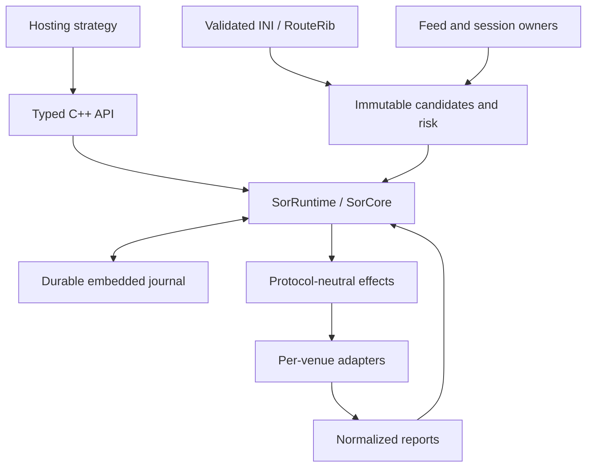

# SORX Wiki

SORX is a deterministic C++20 smart-order-routing codebase. It contains an embedded library for integrating routing into a strategy process and a separate bounded appliance software foundation. This wiki helps users build and exercise the library, developers understand its contracts, and appliance contributors identify the remaining implementation and qualification work.

This wiki documents published source [3234de9](https://github.com/lehajamb/sorx/tree/3234de923d6497b9a119c80485a717ac24d4e6fe), reviewed on 1 November 2026. Examples and source links refer to that revision. Documentation changes are maintained on `codex/wiki-docs` until its documentation PR is merged.

## Choose a starting point

| Goal | Read next |
|---|---|
| Build SORX and see a deterministic two-venue order | [Getting Started](https://github.com/lehajamb/sorx/wiki/Getting-Started) |
| Install libraries or enable optional adapters | [Build and Installation](https://github.com/lehajamb/sorx/wiki/Build-and-Installation) |
| Embed routing in a C++ application | [Embedded Cpp API](https://github.com/lehajamb/sorx/wiki/Embedded-Cpp-API) and [Embedded Configuration](https://github.com/lehajamb/sorx/wiki/Embedded-Configuration) |
| Understand allocations and order ownership | [Routing and Risk](https://github.com/lehajamb/sorx/wiki/Routing-and-Risk) and [Order Lifecycle](https://github.com/lehajamb/sorx/wiki/Order-Lifecycle) |
| Connect market data and order entry | [Market Data](https://github.com/lehajamb/sorx/wiki/Market-Data) and [MockX and QuickFIX Integration](https://github.com/lehajamb/sorx/wiki/MockX-and-QuickFIX-Integration) |
| Recover after a process or session failure | [Persistence and Recovery](https://github.com/lehajamb/sorx/wiki/Persistence-and-Recovery) |
| Work on the appliance foundation | [Appliance Execution Foundation](https://github.com/lehajamb/sorx/wiki/Appliance-Execution-Foundation), [Device Configuration and CLI](https://github.com/lehajamb/sorx/wiki/Device-Configuration-and-CLI), and [Protocol and Connector Foundations](https://github.com/lehajamb/sorx/wiki/Protocol-and-Connector-Foundations) |
| Assess operational readiness | [Operations and Qualification](https://github.com/lehajamb/sorx/wiki/Operations-and-Qualification) |
| Test, troubleshoot, or contribute | [Testing and Troubleshooting](https://github.com/lehajamb/sorx/wiki/Testing-and-Troubleshooting) and [Contributing and Wiki Maintenance](https://github.com/lehajamb/sorx/wiki/Contributing-and-Wiki-Maintenance) |

## Two execution tiers

| Tier | What exists | Integration boundary |
|---|---|---|
| Embedded reference model | `SorCore`, `SorRuntime`, strict INI configuration, durable journal, neutral feed engine, MockX profiles and optional QuickFIX adapter | A hosting process supplies configuration, profile-owned identities, venue views, adapter events and reconciliation. The checked-in demo runs entirely in process. |
| Appliance foundation | Bounded route/risk kernels, exact-frame durable authorization, codecs, configuration, recovery, audit, HA and readiness contracts | Five command shells provide offline validation. Network supervisors, qualified persistence/NIC backends, security services and venue certification remain release gates. |

The appliance foundation does not place `SorRuntime` and its file journal on the proposed appliance hot path. They remain the reference behavioral and recovery model. Portable tests are software evidence; this revision has no measured production latency or destructive power-loss certificate.

The management plane compiles desired configuration, the control plane publishes readiness, and the forwarding plane owns each order transition. Per-venue views are versioned; they do not claim an atomic market snapshot across all venues.

## Contracts to retain

- Prices and quantities use exact integer units. Inexact configured conversions are rejected.
- Aggressive orders are protected IOC; passive orders are non-marketable GTC. Replacement cancels, accounts for terminal ownership, then routes a new revision.
- A successful receipt means validation, ingress sequencing and durable journal acceptance. Venue outcomes arrive asynchronously.
- An ambiguous child retains ownership and risk. Uncertain dispatch is never permission to route the same quantity elsewhere.
- Cancel traffic uses the recorded child mapping and reserved capacity, independent of fresh route selection.
- The appliance production gate rejects volatile reference durability. Its safe shells deliberately refuse runtime activation.

## Documentation and evidence

The [interactive visual guide](https://lehajamb.github.io/sorx/) illustrates the embedded routing, ownership and recovery contracts. It follows its own Pages deployment and can advance beyond this wiki's pinned revision.

The baseline [CI run](https://github.com/lehajamb/sorx/actions/runs/41337726992) passed Windows dependency-free and integration suites (46 and 47 tests). All three Linux builds failed on `AuthVerifyResult` aggregate-initialization warnings treated as errors. See [Testing and Troubleshooting](https://github.com/lehajamb/sorx/wiki/Testing-and-Troubleshooting) before selecting a platform.

Authoritative entry points: [README](https://github.com/lehajamb/sorx/blob/3234de923d6497b9a119c80485a717ac24d4e6fe/README.md), [embedded architecture](https://github.com/lehajamb/sorx/blob/3234de923d6497b9a119c80485a717ac24d4e6fe/docs/SORX_TARGET_ARCHITECTURE.md), [appliance implementation boundary](https://github.com/lehajamb/sorx/blob/3234de923d6497b9a119c80485a717ac24d4e6fe/docs/APPLIANCE_IMPLEMENTATION.md), and [hardware qualification gates](https://github.com/lehajamb/sorx/blob/3234de923d6497b9a119c80485a717ac24d4e6fe/docs/HARDWARE_QUALIFICATION.md).
