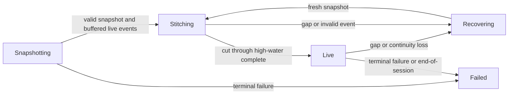

# Market Data

SORX routes against owned, versioned book views. The embedded `sorx::md::FeedEngine` turns normalized snapshot and live events into these views; adapters own wire decoding and transport. The appliance foundation has a separate fixed-capacity L3 book and A/B feed arbiter. Both paths must establish continuity before publishing usable market state.

Start with [Getting Started](https://github.com/lehajamb/sorx/wiki/Getting-Started) to see the embedded engine in the deterministic demo. For native MockX sockets, continue to [MockX and QuickFIX Integration](https://github.com/lehajamb/sorx/wiki/MockX-and-QuickFIX-Integration).

## Embedded feed boundary

| Type | Contract |
|---|---|
| `FeedEngineConfig` | Venue/channel/profile identity, publication depth, and bounded stitch-buffer capacities. The implemented recovery strategy is `FreshSnapshot`. |
| `SnapshotImage` | Normalized events plus the exact live session, next sequence at the snapshot cut, and an end-exclusive live high-water sequence. |
| `PacketFrame` | One already length-decoded sequenced frame. Its declared count must match its events; count `0` is a heartbeat and `0xffff` is end-of-session, both without messages. |
| `EngineUpdate` | State/error/recovery action, applied/skipped counts, publication generation, and an owned vector of `BookView` publications. |
| `BookView` | Fixed arrays of up to 32 bid and 32 ask levels, identity, sequence/version metadata, timestamps, feed/trading state, and an explicit depth-truncation flag. |

The engine accepts directory, trading-state, add, execute, delete, validated book-neutral, and end-of-session events. A profile must validate the original wire type and length before emitting a `KnownBookNeutralEvent`; it cannot use that event to conceal an unrecognized message.

`BookView` prices and quantities use the exact canonical integer units configured for SORX. Views are value objects, not pointers into an adapter's mutable book. Their version includes venue, instrument, feed-session epoch, recovery generation, view generation, and applied/next sequences. There is no single atomic snapshot across venues.

## Establish a snapshot cut



1. Buffer already decoded live packets while waiting for a snapshot of that same session.
2. Apply the snapshot transactionally. It establishes `next_sequence`, then the engine applies eligible buffered live messages and skips already covered messages.
3. Remain in `Stitching` until every sequence in `[snapshot.next_sequence, snapshot.live_high_water_sequence)` has been covered.
4. Call `complete_stitch()` only after that boundary is satisfied. The call validates state and publication time before publishing `Live`.

For example, a cut with `next_sequence=101` and `live_high_water_sequence=104` requires messages 101, 102, and 103 before the engine can become live. Merely receiving a snapshot does not authorize routing.

The engine builds a candidate book before accepting a snapshot or packet. Invalid events cannot leave a partially applied candidate visible. Sequence gaps, a changed session, malformed frames, or bounded-buffer exhaustion take the recovery path. Local clock regression and explicit terminal failures stop the engine. Inspect `EngineUpdate.error` and `recovery`; do not infer recovery instructions solely from a state name.

## Withdraw health before recovering

`continuity_lost()` synchronously publishes a non-live generation before requesting a fresh snapshot. Transport orchestration must call it when bytes are lost before reaching the adapter, including raw-ring overflow or truncated datagrams. Keeping the last prices displayed is not evidence that the view remains eligible for a new route.

| Observation | Integration response |
|---|---|
| `RequestFreshSnapshot` | Obtain a new cut bound to the current live session and stitch again. |
| `Stop` / `Failed` | Stop using the failed instance and diagnose the profile, clock, or transport failure. |
| Non-live book | Publish the health change to the control plane immediately; exclude it from new price-sensitive routing. |
| `depth_truncated=true` | Treat deeper liquidity as unknown; do not invent hidden depth. |
| Live but stale/halted book | Apply freshness and trading-state gates; continuity alone does not establish route eligibility. |

Exchange timestamps, local receive times, and local publication times have separate meanings. The engine validates monotonic local time relationships. [Routing and Risk](https://github.com/lehajamb/sorx/wiki/Routing-and-Risk) explains how book health and the caller-supplied freshness flag participate in an embedded decision. Objective quote-age limits belong to the appliance arbiter described below. Feed loss does not erase existing child ownership or prohibit attempts to cancel known children.

## Appliance market-data foundation

The appliance path uses `sorx::marketdata::FixedL3Book` with startup-sized order, index, price-level, and undo storage. Packet application can fail explicitly for capacity exhaustion, duplicate/unknown order references, overflow, crossed books, decode failure, or invalid context. Accepted updates expose only the changed instrument view. The returned publication span remains valid only until the next non-const operation; a consumer that needs longer ownership must copy the view.

`FeedArbiter` separates inspecting an A/B packet from committing it. `inspect()` can return an application ticket, and the caller completes it through `commit(ticket, application_succeeded)`. Sequence advancement must agree with successful book application. Pending gaps, heartbeat stalls, quote age, session epochs, and failed application can suppress publication; an observed heartbeat is not a fresh quote.

Native ITCH/MoldUDP64 and PITCH codecs are foundations, not certified venue sessions. See [Protocol and Connector Foundations](https://github.com/lehajamb/sorx/wiki/Protocol-and-Connector-Foundations) for their boundaries and [Operations and Qualification](https://github.com/lehajamb/sorx/wiki/Operations-and-Qualification) for missing production services. Market-data mutation is not synchronously journaled through the appliance order recorder.

## Verify the contracts

After the Windows build in Getting Started:

```powershell
ctest --test-dir build-wiki -C Release -R "^sorx_(feed_engine|mockx_md|mockx_md_session|marketdata_foundation|native_marketdata_codec)_tests$" --output-on-failure
```

The neutral-engine tests cover snapshot/high-water binding, gaps, session mismatches, bounded buffering, malformed/end frames, transactional invalid events, clocks, and depth. Native MockX tests add wire framing and loopback transport; the appliance tests exercise the distinct fixed-book and arbitration contracts. These portable checks do not establish network latency or venue certification.

## Source references

- [Embedded feed API](https://github.com/lehajamb/sorx/blob/3234de923d6497b9a119c80485a717ac24d4e6fe/include/sorx/md/feed_engine.hpp)
- [Embedded feed implementation and state transitions](https://github.com/lehajamb/sorx/blob/3234de923d6497b9a119c80485a717ac24d4e6fe/src/feed_engine.cpp)
- [Snapshot, continuity, and publication tests](https://github.com/lehajamb/sorx/blob/3234de923d6497b9a119c80485a717ac24d4e6fe/tests/feed_engine_tests.cpp)
- [Fixed L3 book contracts](https://github.com/lehajamb/sorx/blob/3234de923d6497b9a119c80485a717ac24d4e6fe/include/sorx/marketdata/fixed_l3_book.hpp)
- [Two-phase A/B arbitration contracts](https://github.com/lehajamb/sorx/blob/3234de923d6497b9a119c80485a717ac24d4e6fe/include/sorx/marketdata/feed_arbiter.hpp)
