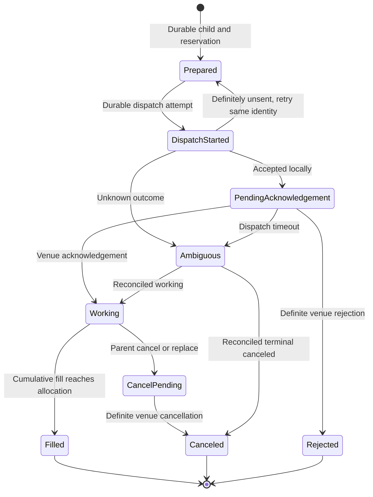

# Order Lifecycle

The embedded coordinator is the sole owner of parent, child, fill, cancellation, replacement, and reservation state. Protocol adapters report facts; they do not independently reassign parent quantity. This page describes `SorCore`/`SorRuntime`; appliance dispatch records and effect permits have their own [execution foundation](https://github.com/lehajamb/sorx/wiki/Appliance-Execution-Foundation).

## Three different acceptance boundaries

| Signal | What it establishes |
|---|---|
| Accepted `CommandReceipt` | Validation, ingress sequencing, and a durable command batch completed. A parent may still have a route rejection or later venue rejection. |
| `LocalDispatchState::AcceptedLocally` | The adapter accepted the specific dispatch attempt locally. The venue outcome is still pending. |
| Normalized venue execution report | A venue acknowledgement, trade, terminal cancellation/rejection, or cancel rejection can advance accounting when its identity and values validate. |

The runtime releases effects and reports only after its logical journal batch is durable. When `poll_egress` returns an effect, the matching `DispatchStarted` record has already been committed. Treat a successful receipt as durable ownership, not a fill or a venue acknowledgement.

## Child ownership states

This diagram highlights the new-order path; cancellation, timeout, reconciliation, and report reordering add transitions beyond the happy path.

| State | Ownership implication |
|---|---|
| `Prepared` | Child, units, wire identity, venue/session mapping, and reservation exist durably; no active dispatch attempt has begun. |
| `DispatchStarted` | A specific attempt has crossed the durable pre-dispatch boundary. Absence of a later result does not prove absence of a send. |
| `PendingAcknowledgement` | Local acceptance has been recorded; venue acknowledgement remains outstanding. |
| `Working` | A validated venue report or reconciliation establishes an active child. |
| `CancelPending` | Cancellation intent exists; fills can still race with the request. |
| `Ambiguous` | The outcome is uncertain. Keep ownership and reservation until reconciliation proves a safe disposition. |
| `Filled`, `Canceled`, `Rejected` | Definite terminal states. Accounting preserves fills and explicitly accounts for remaining quantity. |

An unknown dispatch suspends the parent. It never authorizes a new child at another venue for the same quantity. A definitely-unsent new attempt can return to `Prepared` and retry using the same durable wire ID. An unknown cancel outcome also preserves uncertainty rather than proving cancellation.

## Parent state and quantity

Parents pass through `Routing` and typically `Active`. Cancellation and replacement introduce `CancelPending` and `ReplacePending`; ambiguous ownership produces `Suspended`. Terminal states are `Filled`, `Canceled`, and `Rejected`.

Track cumulative fills, outstanding child ownership, and explicit remainder together. For the default IOC demo, 10 units become children of 4 and 6; after both fill, the parent is `Filled`, cumulative filled is 10, and held risk is zero. If IOC children become terminal with less than the requested quantity filled, the parent becomes `Canceled` with an explicit remainder. The system does not infer a new routing obligation from that remainder.

A route can reject a durably accepted parent because no executable/eligible allocation exists. Distinguish that parent report from a command rejected before ownership was established. `trace()` can explain current eligibility without changing state, but it cannot reserve the future inputs of a later command.

## Cancellation uses the recorded child mapping

`cancel(parent)` uses each child's original venue, session epoch, wire symbol, and wire identity. It does not perform a fresh route lookup. A missing/stale feed can block new price-sensitive routing while cancellation of a known child remains valid.

Cancel/risk-off egress has reserved capacity and is drained before new/replacement traffic for a venue. An undispatched `Prepared` child with no active attempt can be canceled locally; stale queued new effects then fail their dispatch validation. If cancellation races with an active new dispatch, the coordinator waits for that attempt's outcome before deciding whether a wire cancel is needed.

Check the cancellation receipt and follow later reports. Local acceptance of a cancel is not a definite venue cancellation, and a cancel rejection does not erase the original order.

## Replacement is cancel, account, then reroute

`ParentReplace` names the parent, a **new total quantity**, and a new limit price. It is not an additional quantity. A requested total below already filled quantity is rejected. The existing instrument, side, and routing intent remain attached to the parent.

1. Validate the replacement and persist its intent.
2. Cancel old nonterminal children and retain their ownership until their outcomes are definite.
3. Account for racing fills before computing the replacement's remaining quantity.
4. If the new total is already met or exceeded by those fills, finish without another child.
5. Otherwise increment the parent revision and route `new total - cumulative fills` under the replacement limit.

An unresolved old child prevents safe rerouting. New child IDs and profile-owned wire identities belong to the new revision. This is coordinator-level replacement; it is not an instruction to reuse an existing child as an unrelated new order.

## Identity, duplicates, and recovery

Local dispatch results must match the durable child, attempt kind/ID, venue, session epoch, and wire ID. Results with default or stale attempt metadata are rejected. Execution processing validates session/wire identity, cumulative quantities, and exact value conversion; duplicate reports must not add fills twice.

An identical submission of the stored parent order is an idempotent replay. A conflicting order under the same parent ID is rejected. This does not authorize inventing a new parent ID to replay an order whose dispatch outcome is unknown.

Recovery restores durable ownership and deduplication state. It classifies unresolved children before admitting new routing, retaining risk for ambiguous quantity. MockX lacks an order-status query in this revision, so external reconciliation remains necessary for uncertain nonterminal children. See [Persistence and Recovery](https://github.com/lehajamb/sorx/wiki/Persistence-and-Recovery).

## Source references

- [State, event, effect, and report definitions](https://github.com/lehajamb/sorx/blob/3234de923d6497b9a119c80485a717ac24d4e6fe/include/sorx/order_core.hpp)
- [Lifecycle and reconciliation implementation](https://github.com/lehajamb/sorx/blob/3234de923d6497b9a119c80485a717ac24d4e6fe/src/order_core.cpp)
- [Dispatch identity, retry, timeout, and cancel-race tests](https://github.com/lehajamb/sorx/blob/3234de923d6497b9a119c80485a717ac24d4e6fe/tests/dispatch_lifecycle_tests.cpp)
- [Cancel/replace, report ordering, and ownership tests](https://github.com/lehajamb/sorx/blob/3234de923d6497b9a119c80485a717ac24d4e6fe/tests/order_core_tests.cpp)
- [Reservation release and ambiguous-retention tests](https://github.com/lehajamb/sorx/blob/3234de923d6497b9a119c80485a717ac24d4e6fe/tests/risk_conservation_tests.cpp)
