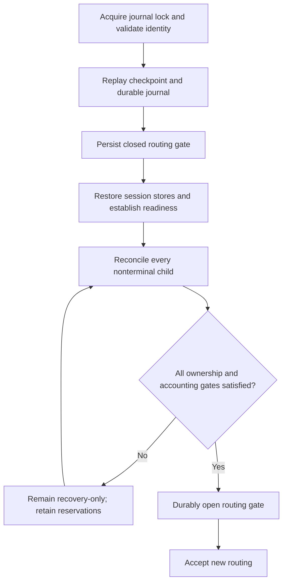

# Persistence and Recovery

The embedded `SorRuntime` makes order ownership durable before external effects escape. Recovery restores that ownership and asks what can be proved about every nonterminal child. A process restart, FIX reconnect, or fresh market snapshot does not make an uncertain order safe to resend elsewhere.

This page describes the embedded filesystem journal and runtime. The appliance recorder, exact-frame permits, and bounded recovery ledgers are separate contracts described in [Appliance Execution Foundation](https://github.com/lehajamb/sorx/wiki/Appliance-Execution-Foundation).

## What is durable

Each accepted coordinator transition appends its deterministic records and a complete runtime state image as one logical batch. The runtime releases resulting effects and reports only after the journal commit. A successful `CommandReceipt` means validation, ingress sequencing, and durable acceptance; it does not mean the venue has acknowledged or filled an order.

Before `poll_egress()` returns a dispatch, the runtime records `DispatchStarted`. Thus a crash after the caller obtains that effect is potentially after transmission even if the caller never reports its local outcome. Recovery must preserve that uncertainty.

| Mechanism | Embedded contract |
|---|---|
| Canonical encoding | Explicit big-endian integers and length-prefixed variable fields; no native object layout, pointers, or padding on disk |
| Journal header | Schema version, account context, and 32-byte route-critical configuration hash |
| Logical batch | Checksums, monotonic record/batch IDs, and a validated commit marker |
| Append completion | `fflush` plus the operating system's durable file-flush primitive before success returns |
| Ownership lock | Nonblocking exclusive process lock retained for the journal object's lifetime |
| Checkpoint | Checksummed state written to a temporary file, flushed durably, and atomically substituted |

This is a software durability contract using the filesystem and OS. It is not evidence of appliance hardware power-loss qualification.

## Journal and checkpoint paths

`RuntimeConfiguration` supplies `journal_path`, optional `checkpoint_path`, and a positive `checkpoint_interval_batches` (default 64). If no checkpoint path is provided, the runtime uses the journal path followed by `.checkpoint`. Use an application-owned durable directory and retain the matching validated configuration and profile identity.

A missing checkpoint is normal. A present checkpoint must validate against the expected header and cannot be ahead of the journal's last record or batch. After loading it, the runtime applies later complete state-image records. A journal containing records but no usable complete runtime image is incompatible.

Checkpoints accelerate replay. Failure to write a checkpoint after a committed batch does not invalidate that durable batch; the runtime retries checkpointing after a later batch. In contrast, journal append failure rolls the in-memory transition back, marks the runtime failed, and returns `JournalFailure` before releasing its effects.

## Replay rules

| Evidence on disk | Result |
|---|---|
| Complete valid committed batch | Replay it once in recorded order and continue record/batch IDs monotonically |
| Incomplete uncommitted tail | Ignore it; journal opening truncates back to the validated prefix before appending |
| Corruption in committed history or invalid commit marker | Reject replay rather than accepting a partial history |
| Different schema, account, or route-critical hash | Reject the incompatible journal/checkpoint |
| Another live journal owner | Fail acquisition of the exclusive lock |

Do not remove a lock file, rewrite a header, discard a checkpoint, or edit record bytes to make uncertain recovery pass. Diagnose the mismatch and retain evidence. A route-critical configuration change is not a way to remap an existing child's ownership; [Embedded Configuration](https://github.com/lehajamb/sorx/wiki/Embedded-Configuration) explains which inputs define the hash.

## Startup stays recovery-only



`SorRuntime` starts in recovery mode even with a new empty journal. Construction restores the core, identifiers, and ingress sequence before the venue runtimes are started. Recovered active dispatch attempts, `DispatchStarted`, and `PendingAcknowledgement` children are treated as uncertain and suspended through the normal durable event path.

Adapters publish protocol-neutral `ReconciliationEvent` values containing a child identity, disposition, and cumulative fill quantity. Supported dispositions include definitely unsent, working, terminal canceled/filled/rejected, and unresolved. Their values must come from valid evidence, not a desire to reopen the gate.

`complete_recovery()` succeeds only when the outstanding reconciliation set is empty and the core's recovery consistency checks pass. It persists the gate-opening transition before clearing `recovery_pending()`. A ready network connection alone cannot bypass this check.

## Decide whether retry is permitted

| Crash boundary / evidence | Ownership consequence |
|---|---|
| No complete durable command batch | No released effect from that batch; retry the command according to its identity/idempotency contract |
| Durable child remains `Prepared` | It is provably unsent; definitely-unsent reconciliation can requeue the same child and original wire identity |
| Dispatch may have escaped, no definitive outcome | Child becomes `Ambiguous`, parent is suspended, and outstanding quantity/risk remain owned |
| Definite working state | Retain the working child and account its known fills; do not allocate its remaining quantity to another venue |
| Definite terminal result | Apply final cumulative fills and release only the remaining reservation allowed by that result |

The MockX adapter has no order-status query. Its conservative helper classifies only `Prepared` as definitely unsent; all other nonterminal children remain unresolved. A `Working` or `CancelPending` state recovered from local disk is not, by itself, current venue evidence. See [MockX and QuickFIX Integration](https://github.com/lehajamb/sorx/wiki/MockX-and-QuickFIX-Integration).

Cancel and replacement recovery preserve recorded venue/session/wire mappings. Replacement waits for terminal or reconciled ownership before rerouting a new parent revision. A timeout is not a terminal execution result. [Order Lifecycle](https://github.com/lehajamb/sorx/wiki/Order-Lifecycle) explains the normal transitions that recovery must preserve.

## Exercise failure boundaries

After the Windows build in Getting Started:

```powershell
ctest --test-dir build-wiki -C Release -R "^sorx_(journal|recovery_state|crash_matrix|dispatch_lifecycle|risk_conservation)_tests$" --output-on-failure
```

The journal tests cover torn-tail removal, corruption rejection, lock exclusion, checkpoint validation, and ID continuity. The crash matrix reopens journals at pre-commit, committed/pre-wire, post-wire/pre-ack, partial-fill, cancel, and replacement boundaries. Repeated replay must preserve wire identities and risk instead of creating a second owner.

These tests use isolated temporary storage. Their success does not certify a disk/controller, a deployment filesystem, real venue reconciliation, or the appliance's physical recorder. Qualification requirements are tracked in [Operations and Qualification](https://github.com/lehajamb/sorx/wiki/Operations-and-Qualification).

## Source references

- [Journal, canonical encoding, and checkpoint API](https://github.com/lehajamb/sorx/blob/3234de923d6497b9a119c80485a717ac24d4e6fe/include/sorx/persistence/journal.hpp)
- [Filesystem durability, replay, and truncation implementation](https://github.com/lehajamb/sorx/blob/3234de923d6497b9a119c80485a717ac24d4e6fe/src/persistence/journal.cpp)
- [Runtime replay, journal-before-effects ordering, and recovery gate](https://github.com/lehajamb/sorx/blob/3234de923d6497b9a119c80485a717ac24d4e6fe/src/runtime.cpp)
- [Journal failure-boundary tests](https://github.com/lehajamb/sorx/blob/3234de923d6497b9a119c80485a717ac24d4e6fe/tests/journal_tests.cpp)
- [Runtime crash/restart matrix](https://github.com/lehajamb/sorx/blob/3234de923d6497b9a119c80485a717ac24d4e6fe/tests/crash_matrix_tests.cpp)
