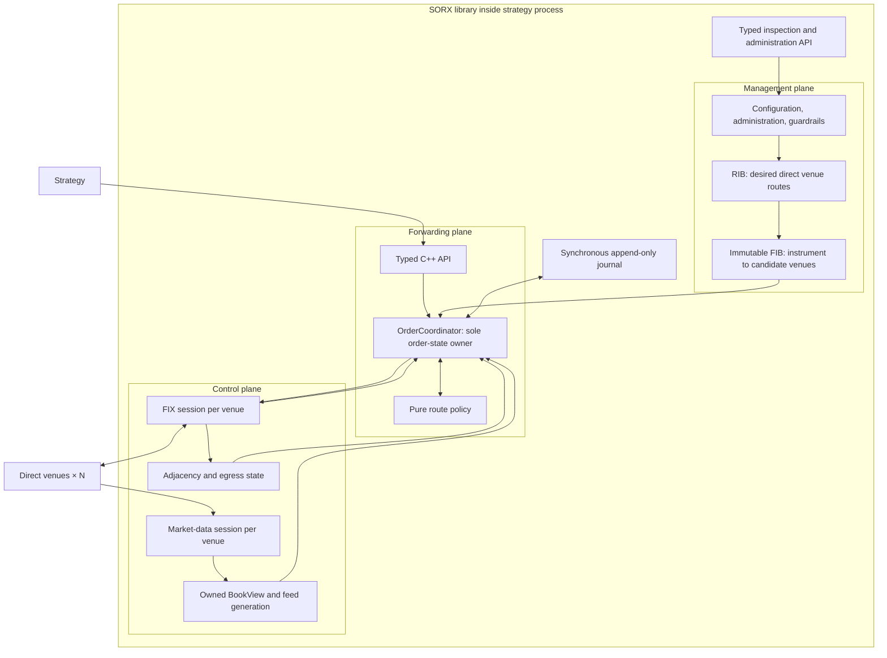

# SORX Target Architecture

## Summary

Build SORX as a new C++20 library embedded in the strategy process. It will be a long-running, multi-venue order router with three logical Cisco-style planes, direct one-hop venues, protocol-specific adapters, deterministic routing, durable single-active recovery, and hard pre-trade guardrails.

Decisions locked:

- Static, configured venue inventory; no discovery, BGP/OSPF, longest-prefix matching, multi-hop forwarding, or internal microservices.
- Typed C++ northbound API only.
- Aggressive protected IOC and passive GTC parents.
- Parent cancel and cancel-then-reroute replace.
- Best-price/displayed-depth aggressive policy; deterministic single-venue passive policy.
- MockX ITCH/GLIMPSE and FIX 4.4 profiles first.
- Persist parent commands and child intent synchronously before transmission.
- One SORX instance represents one account/routing context.
- No active/standby HA, execution algorithms, broad portfolio risk, or automatic post-dispatch liquidity chasing.



## Architecture

### Management plane

- `RouteRib` is the authoritative configured inventory of venues, instruments, wire-symbol mappings, exact price/quantity conversions, capabilities, limits, priorities, and administrative state.
- `FibCompiler` publishes an immutable `CandidateTable` keyed by canonical instrument. Each entry contains flat candidate handles and static routing metadata.
- Recompile the FIB only for configuration, administrative state, or instrument-directory changes—not for quotes, heartbeats, or transient disconnects.
- Operational route status is a computed RIB view combining configuration and adjacency state, not a second independently mutable database.
- Expose typed C++ operations equivalent to `show interfaces`, `show rib`, `show fib`, `show market`, `show order`, `trace order`, venue shutdown/start, and kill switch. SORX itself will not embed an HTTP server or IOS-like shell.
- Administration and kill-switch changes enter the coordinator as ordered, journaled events; management code never mutates forwarding state directly.

### Control plane and adjacency

Create one `VenueRuntime` for every configured venue:

- `MarketDataSession`: transport, ITCH dialect, snapshot provider, continuity/recovery state, and thread-confined L3 book.
- `OrderEntrySession`: QuickFIX session plus venue-specific FIX dialect.
- `AdjacencyState`: immutable versioned readiness view.
- Two bounded egress classes:
  1. cancels and risk-off;
  2. new and replacement orders.
- Reserved cancel capacity; no silent queue drops.

Use these state dimensions:

```text
Admin:        UP | DOWN
Market data:  SNAPSHOTTING | STITCHING | LIVE | RECOVERING | FAILED
Order entry:  DISCONNECTED | CONNECTING | READY | DEGRADED
Egress:       READY | CONGESTED
Instrument:   UNKNOWN | TRADING | HALTED | CLOSED
```

Derive:

```text
can_send_new =
    admin UP
    + FIX READY
    + feed LIVE and sufficiently fresh
    + instrument TRADING
    + egress capacity available

can_cancel =
    known active child
    + FIX session able to accept cancels
```

Cancels always use the child’s recorded venue/session mapping and never perform a FIB lookup.

### Forwarding plane and concurrency

- A single `OrderCoordinator` owns every parent, child, fill, risk reservation, ID mapping, cancel, replace, and recovery transition.
- Market-data and FIX threads publish immutable normalized events through bounded queues. The coordinator assigns a monotonic `core_ingress_sequence`.
- The full L3 book remains on its feed thread. Cross-thread publication uses owned, fixed-capacity `BookView` values rather than borrowed `OrderBook&` or `std::span`.
- `BookView` carries venue/channel/profile IDs, instrument, depth, feed session epoch, recovery generation, last-applied/next sequence, exchange timestamp, local monotonic receive/publication times, trading state, and a depth-truncated flag.
- There is no claim of an atomic cross-venue market snapshot. Each decision records the exact version pinned for every candidate.
- Keep a deterministic synchronous `SorCore::apply(event)` for tests and replay; `SorRuntime` supplies threads, queues, clocks, persistence, and network sessions.
- Do not shard the coordinator until measurements demonstrate a need. Later sharding must preserve single ownership of each parent and its risk reservations.

## Public contracts and routing behavior

### C++ API

```cpp
enum class RoutingIntent {
    AggressiveIOC,
    PassiveGTC,
};

struct ParentOrder {
    ParentOrderId id;
    InstrumentId instrument;
    Side side;
    Quantity quantity;
    Price limit_price;
    RoutingIntent intent;
};

struct ParentReplace {
    ParentOrderId id;
    Quantity new_total_quantity;
    Price new_limit_price;
};

class SorRuntime {
public:
    CommandReceipt submit(const ParentOrder&);
    CommandReceipt cancel(ParentOrderId);
    CommandReceipt replace(const ParentReplace&);

    RouteTrace trace(const ParentOrder&) const;
    SorSnapshot inspect() const;
    void set_report_sink(IParentReportSink&);
};
```

- A successful `CommandReceipt` means the command has been validated, assigned an ingress sequence, and durably journaled.
- Parent acknowledgements, fills, cancels, rejects, and suspension reports are asynchronous.
- Replace quantity is the new total parent quantity. Reject replacement below already-filled quantity.
- Prices and quantities use exact integer units defined by canonical instrument metadata. Venue profiles must convert exactly or fail configuration validation; floating-point arithmetic is prohibited.

### Aggressive IOC

1. Apply hard risk guardrails.
2. Pin FIB, adjacency, risk-config, and per-venue book generations.
3. Exclude unavailable, halted, stale, incompatible, congested, or risk-prohibited candidates and record a reason.
4. K-way merge executable opposite-side levels:
   - best canonical price;
   - configured venue priority;
   - stable venue ID.
5. Respect the parent limit, displayed depth, configured maximum venues, venue allocation cap, and parent quantity.
6. Once the maximum venue count is reached, continue consuming eligible levels from already-selected venues but do not introduce another venue.
7. Produce at most one limit-IOC child per venue, priced at that venue’s worst allocated level.
8. Treat depth beyond a truncated `BookView` as unknown, not absent liquidity.
9. Perform at most one replan if a pinned generation changes before child persistence.
10. After any child is persisted for dispatch, never chase or reallocate its quantity automatically.

Unbounded market orders are not supported. A market-like request must arrive as an IOC with an explicit protection limit.

### Passive GTC

- `PassiveGTC` must be non-marketable at the decision snapshot; otherwise reject it and require the caller to submit an aggressive IOC followed by a passive order.
- Route the full allowed quantity to exactly one venue.
- Default ranking is configured passive venue priority, then configured latency, then stable venue ID.
- The child remains until filled, canceled, or replaced. There is no automatic queue chasing or venue rebalancing.
- Parent cancel sends a cancel directly to the active child.
- Parent replace:
  1. durably record replace intent;
  2. cancel the active child;
  3. wait for terminal cancel/fill results;
  4. calculate remaining quantity;
  5. create a new parent revision;
  6. route the revision using the new terms.
- Do not use native venue cancel/replace initially; venue-specific optimization may be added later only if its semantics are equivalent.

### Risk and failure semantics

Hard guardrails include:

- instrument and venue permissions;
- maximum parent/child quantity and notional;
- price/protection collars;
- maximum open parents and children;
- gross outstanding leaves by instrument;
- per-venue exposure;
- kill switch and venue shutdown.

Risk reservations are part of the durable `ChildPrepared` batch and are released only by terminal accounting.

Wire dispatch is never described as atomic:

- Before FIX acceptance: definitely unsent children may be retried with the same durable wire ID.
- After local FIX acceptance: the child owns its quantity.
- Disconnect or timeout without a definitive response produces `AMBIGUOUS`; the child and parent are suspended and their quantity is never routed elsewhere.
- A definite reject releases the child’s risk reservation and becomes an explicit parent remainder; no automatic post-dispatch reroute.
- Feed failure removes the venue from new price-sensitive routing but never blocks cancellation attempts.

Execution reports are deduplicated using `(venue, session epoch, ExecID)`. Logical parent/child IDs remain protocol-neutral; each FIX profile creates a durable, venue-valid `ClOrdID`.

## Protocol reuse, persistence, and operations

### Market data

Factor the efficient machinery from `cpp_market_feed` into a neutral reusable library while leaving `cpp_sor` source and behavior unchanged:

- Preserve direct UDP receive into bounded SPSC storage, strict framing, single-writer L3 book, GLIMPSE/live stitching, exact integer prices, and fail-closed continuity handling.
- Keep `mockx_feed_core` as the compatibility facade used by the examples.
- SORX consumes neutral `sorx::md` types and never imports `mockx::feed` types.
- Separate deterministic `FeedEngine` state from socket/thread orchestration.
- Make recovery a profile strategy. MockX initially uses fresh-GLIMPSE recovery; a later production profile may use Mold rerequests followed by snapshot fallback.
- Known book-neutral ITCH messages may be validated and ignored; unknown message types or lengths withdraw the feed.

The current handler implements the MockX message subset. Real Nasdaq TotalView also requires attributed adds, partial cancels, replaces, and operational-status handling; production MoldUDP64 supports rerequests. These belong in a later `NasdaqTotalViewItch50` profile, not in the routing core. [Nasdaq TotalView ITCH 5.0](https://www.nasdaqtrader.com/content/technicalsupport/specifications/dataproducts/NQTVITCHspecification.pdf), [Nasdaq MoldUDP64](https://www.nasdaqtrader.com/content/technicalsupport/specifications/dataproducts/moldudp64.pdf)

### FIX

Provide one order-entry profile per venue dialect:

- `MockXFix44Profile` first.
- Later `NasdaqInetFix42Profile`, with its own dictionary, required tags, ID lengths, sequence/reset rules, resend handling, execution-state mapping, and reconciliation capability.

FIX version alone is insufficient to define a venue contract. Nasdaq currently advertises FIX 4.2/4.1/4.0 rather than MockX’s FIX 4.4, so Nasdaq deployment is a new profile plus certification—not a configuration switch. [Nasdaq FIX](https://www.nasdaqtrader.com/Trader.aspx?id=FIX)

Resolve profile dispatch once per session; do not use per-message virtual calls in ITCH decoding or FIX normalization.

### Durable single-active recovery

Use a checksummed append-only local journal with monotonic record IDs, an exclusive process lock, and periodic replay checkpoints.

Journal before external side effects:

- parent submit/cancel/replace;
- route decision and exclusion reasons;
- risk reservations;
- child logical and wire IDs;
- `ChildPrepared`;
- local dispatch result;
- normalized execution reports;
- parent and child terminal outcomes;
- administrative and kill-switch changes.

Startup sequence:

1. Acquire exclusive journal ownership.
2. Validate the route-critical configuration/profile hash.
3. Replay journal and restore parents, children, risk reservations, ID counters, and session epochs.
4. Restore QuickFIX sequence stores.
5. Start venue sessions in recovery mode; new routing remains disabled.
6. Reconcile every nonterminal child using profile-supported status/cancel flows.
7. Mark unresolved children `AMBIGUOUS` and keep their parents suspended.
8. Enable new routing only after market data is live and recovery accounting is consistent.

If route-critical configuration changes while nonterminal children exist, startup fails rather than silently remapping them.

Store immutable `RouteDecisionRecord` and `ExecutionOutcomeRecord` separately. Wall-clock processing durations belong in metrics, not deterministic journal records.

## Test and acceptance plan

- Pure routing tests:
  - multi-venue price/depth sweeps;
  - deterministic equal-price ties;
  - limits, caps, truncated depth, and insufficient liquidity;
  - unavailable/stale/halted venues;
  - passive single-venue selection;
  - no over-allocation or price violation.
- State/property tests:
  - duplicate and reordered reports;
  - partial fills during cancel/replace;
  - fill, canceled, rejected, and ambiguous accounting;
  - parent quantity and risk-reservation conservation.
- Persistence crash matrix:
  - before journal commit;
  - after commit but before FIX submission;
  - after submission but before acknowledgement;
  - after partial fill;
  - during cancel and replace;
  - repeated replay produces identical state and no duplicate child IDs.
- Feed tests:
  - retain existing ring, decoder, book, GLIMPSE, continuity, and live-smoke coverage;
  - verify owned snapshot generations and guaranteed health invalidation.
- Multi-MockX integration:
  - configured N venues;
  - venue withdrawal without stopping other venues;
  - ITCH gaps and resynchronization;
  - FIX disconnect/reconnect;
  - GTC rest, fill, cancel, and replace;
  - egress saturation and cancel priority;
  - same-time events, duplicate reports, and venue restart.
- Determinism:
  - deterministic core tests use explicit ordered events;
  - network-mode runs record normalized transcripts;
  - replaying a transcript must reproduce decisions and accounting byte-for-byte.
- Regression acceptance:
  - existing `cpp_sor` remains unchanged and passes;
  - the full MockX suite passes;
  - SORX core contains no MockX, QuickFIX, Mold, Soup, GLIMPSE, or ITCH wire types;
  - adding a production venue affects only profile/adaptor code, configuration, and conformance tests.

Assumptions:

- MockX profile ships first; the first release is architecturally portable but not yet certified or directly runnable against Nasdaq.
- Venue inventory and capacity bounds are required startup configuration.
- One SORX instance serves one account/routing context.
- No explicit latency SLA was supplied; use bounded queues, preallocated hot-path storage, and a single coordinator, then optimize from benchmarks without weakening durability or accounting.
